<p align="center">
  <a href="https://foresight-ai.up.railway.app">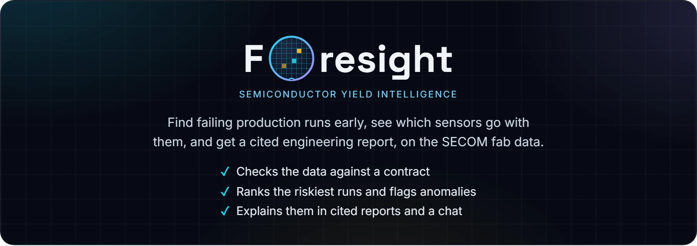</a>
</p>

<p align="center">
  <a href="https://github.com/RavidEliav/foresight/actions/workflows/ci.yml"></a>
  
  
  
  
  
  
  
  
</p>

<p align="center">
  <a href="https://foresight-ai.up.railway.app"><b>Live app</b></a> ·
  <a href="#see-it">Screenshots</a> ·
  <a href="#how-it-works">How it works</a> ·
  <a href="#rag-and-embeddings">RAG</a> ·
  <a href="#results">Results</a> ·
  <a href="#quick-start">Quick start</a> ·
  <a href="docs/Architecture/Technical%20reference.md">Technical reference</a>
</p>

<p align="center">
  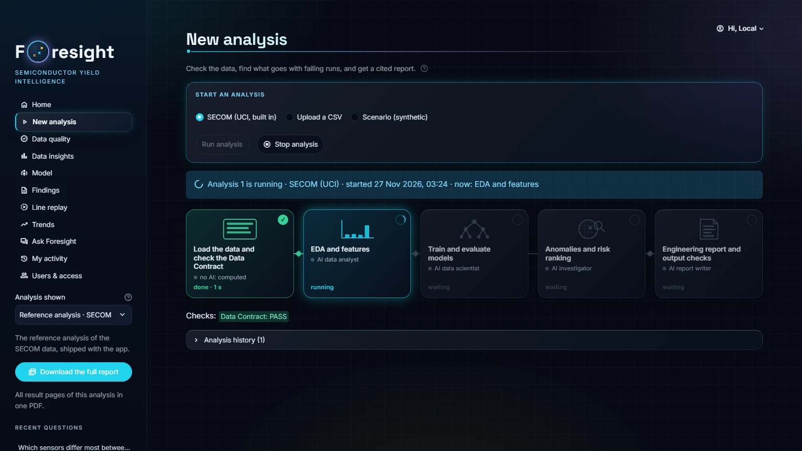
</p>

Author: **Ravid Eliav** · AI Developers Course, Final Project

## What it does

A wafer fab records hundreds of sensor readings for every production run, and a few runs fail the final test. Foresight takes that data and, in about two and a half minutes:

- **checks the data** against a Data Contract before anything else runs;
- **finds what goes with failing runs:** sensors that differ, anomalies, similar past runs;
- **ranks the riskiest runs** with a model that is honest about how weak the signal is;
- **writes a cited engineering report** with facts, assumptions and hypotheses kept apart, and checks it automatically before anyone reads it;
- **answers questions** about any analysis, or across all of them, only from its reports and with sources.

**Python computes every number; AI agents interpret them.** Four CrewAI crews (AI data analyst, AI data scientist, AI investigator, AI report writer) read the results through read-only tools, and 26 automatic checks reject a report that invents a number, a sensor or a cause.

| Environment | Branch | URL |
|---|---|---|
| `main` (stable) | `main` | https://foresight-ai.up.railway.app |
| `dev` (testing) | `dev` | https://foresight-app-dev.up.railway.app |

The app is behind Google sign-in: a new visitor asks for access, and a developer approves it by email.

## See it

Every page, in the menu's order:

<table>
  <tr>
    <td width="50%" valign="top">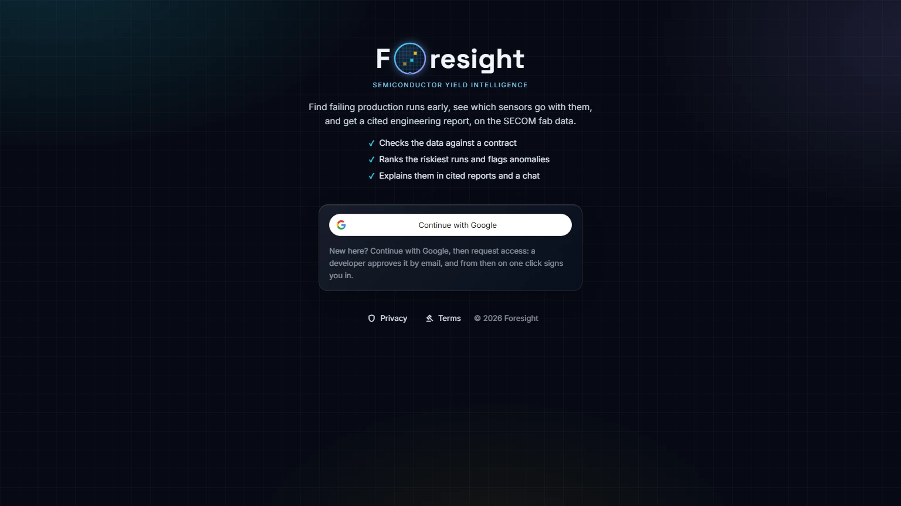<br><b>Sign-in.</b> Google sign-in; a new visitor asks for access and is approved by email.</td>
    <td width="50%" valign="top">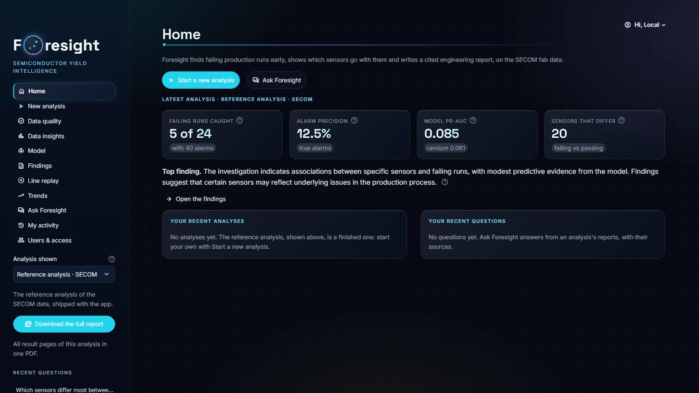<br><b>Home.</b> The analysis at a glance, its top finding, and a PDF report of every page.</td>
  </tr>
  <tr>
    <td valign="top"><br><b>New analysis.</b> Five stages with live progress and checks between them; stop and resume.</td>
    <td valign="top">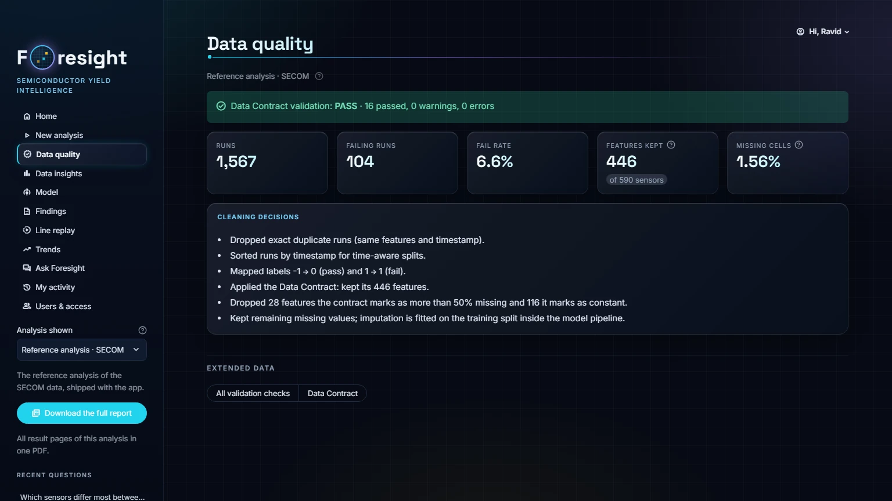<br><b>Data quality.</b> The Data Contract validation and every cleaning decision.</td>
  </tr>
  <tr>
    <td valign="top">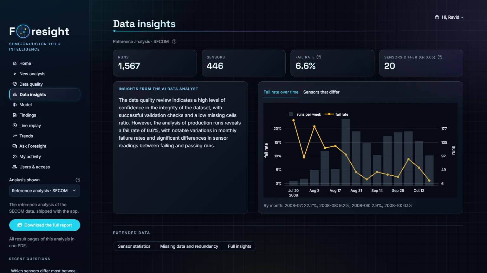<br><b>Data insights.</b> Fail rate over time, the sensors that differ, the AI data analyst's summary.</td>
    <td valign="top">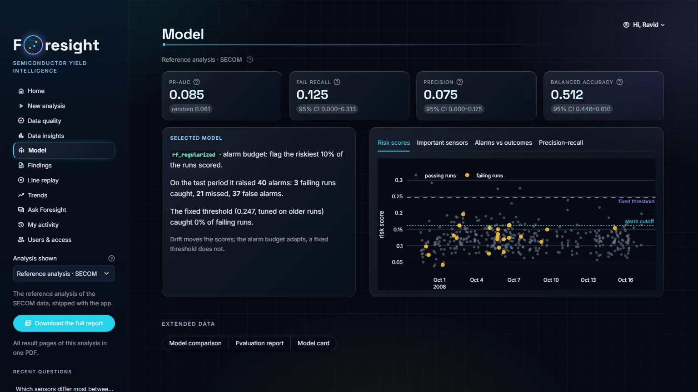<br><b>Model.</b> Metrics with 95% confidence intervals against random guessing, and why the alarm budget beats a fixed threshold.</td>
  </tr>
  <tr>
    <td valign="top">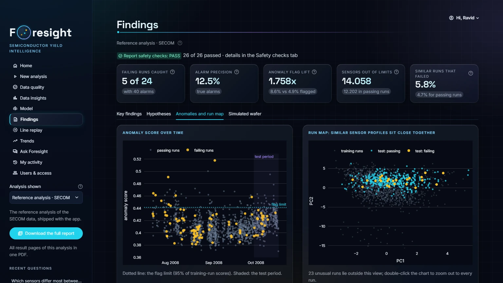<br><b>Findings.</b> Key findings, hypotheses with how to verify them, the anomaly timeline and the run map.</td>
    <td valign="top">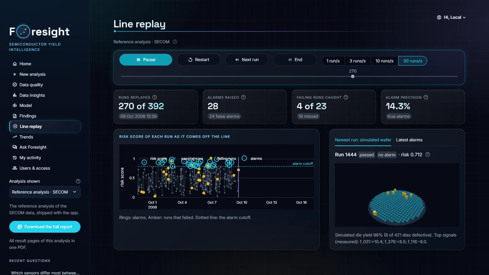<br><b>Line replay.</b> The test period played back run by run: alarms, catches and a simulated wafer of the newest run.</td>
  </tr>
  <tr>
    <td valign="top">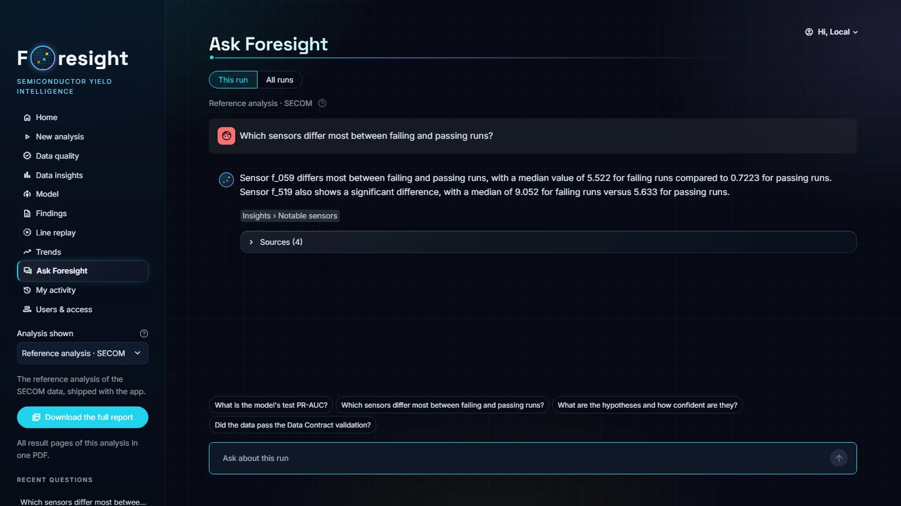<br><b>Ask Foresight.</b> Answers only from the analysis's reports, with sources; anything else is refused.</td>
    <td valign="top"></td>
  </tr>
</table>

On a phone every page fits the screen, and a page's cards become tabs:

<table>
  <tr>
    <td width="25%" valign="top">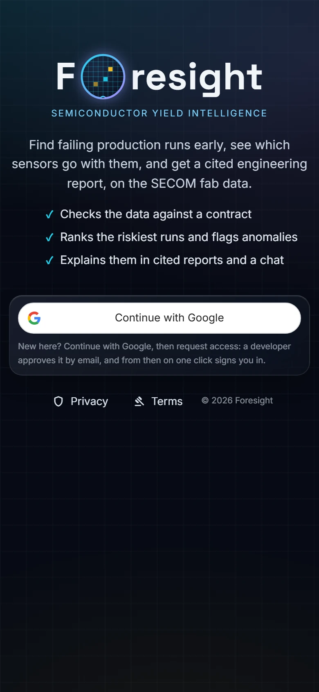<br><b>Sign-in</b></td>
    <td width="25%" valign="top">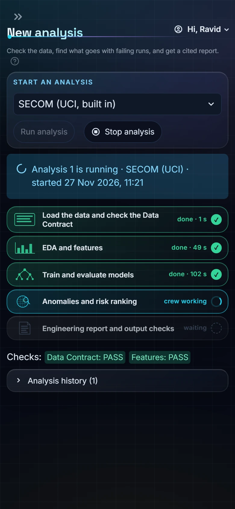<br><b>New analysis</b></td>
    <td width="25%" valign="top">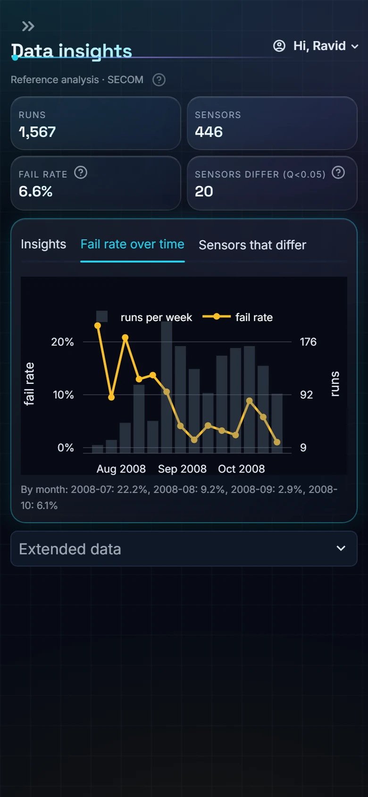<br><b>Data insights</b></td>
    <td width="25%" valign="top">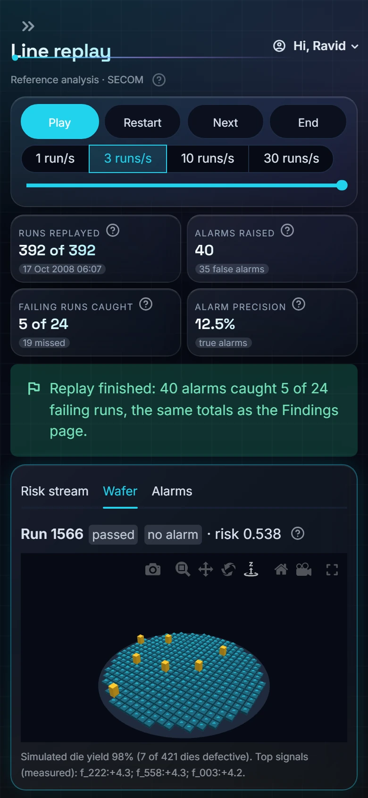<br><b>Line replay</b></td>
  </tr>
</table>

## How it works

<p align="center">
  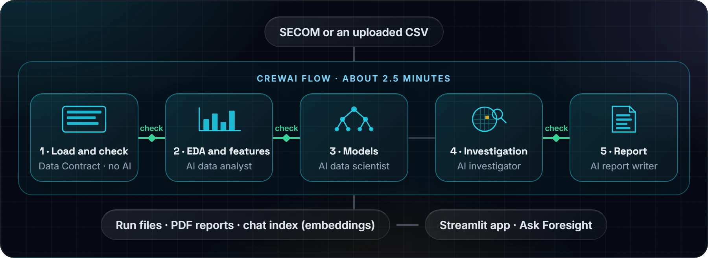
</p>

1. **Load and check.** The raw files are validated, cleaned (features over 50% missing and constant ones dropped, the rest kept and imputed on the training split only) and checked against the committed Data Contract. An error stops the run with a plain-language reason.
2. **EDA and features.** Mann-Whitney U per sensor with Benjamini-Hochberg q-values; a time-ordered split (the last 25% of runs is the test period); near-duplicate sensors dropped.
3. **Models.** Four models and an always-pass baseline, chosen by time-ordered cross-validation on the training period. The operating point is an **alarm budget** (flag the riskiest 10%), because the data drifts and a fixed threshold stops alarming. Test metrics come with bootstrap confidence intervals.
4. **Investigation.** IsolationForest and SPC z-scores fitted on training runs, a risk ranking that adds the anomaly score only if cross-validation says it helps, and similar past runs.
5. **Report.** The AI report writer drafts from fact sheets in which every fact names its source file. The checks then require every number to trace to the run's files, every sensor to exist, every hypothesis to state its confidence, and no causal wording. A crew whose output fails gets one revision.

Every AI step can run on a **deterministic mock LLM** (`MOCK_LLM=true`), which goes through the same agents, tasks and checks. Tests and CI use it, so they never spend a token.

## RAG and embeddings

<p align="center">
  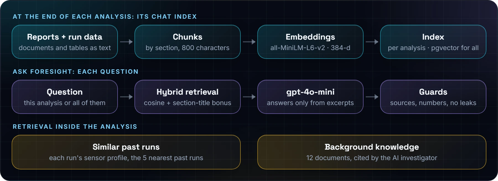
</p>

- **Embeddings** come from a local model, all-MiniLM-L6-v2 through ONNX Runtime (384 dimensions): free, no API key, downloaded once (about 80 MB).
- **The chat index.** At the end of each analysis, its reports and its tables written out as text (`run_data.md`) are chunked by section (800 characters, 120 overlap) and embedded. The index is kept with the analysis, and in Supabase **pgvector** (HNSW, cosine) for questions across all analyses.
- **Ask Foresight** retrieves with cosine similarity plus a bonus when the question's words match a section title or a run number. Below similarity 0.25 it answers "Not found in this run's artifacts." without calling the LLM; otherwise gpt-4o-mini answers only from the excerpts and cites them. An answer without a valid source, with a number that is not in the excerpts, with a causal claim, or with anything shaped like a secret is withheld.
- **Inside the analysis,** the AI investigator gets the 5 most similar past runs of the riskiest and the failing test runs (each run's sensor profile, reduced to 30 dimensions) and passages from 12 background documents, which it cites as Background, never as evidence.
- **Measured:** hit@1 86% and hit@4 93% on 28 questions about the reference analysis, every out-of-scope question refused before any LLM call, and 0 unsafe answers to 23 prompt-injection attacks ([results](docs/Results)).

## Results

<p align="center">
  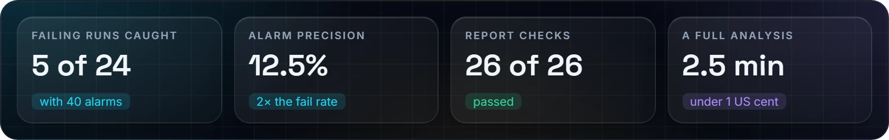
</p>

On the real SECOM data (the [reference analysis](artifacts/reference), gpt-4o-mini, every check passing):

| Measure | Result |
|---|---|
| Failing runs caught in the test period | **5 of 24** with 40 alarms (21%, 95% CI 4–35%) |
| Alarm precision | **12.5%**, about twice the test period's fail rate (6.1%) |
| Model PR-AUC | 0.085 vs 0.061 for random guessing |
| Report checks | **26 of 26** passed, no revisions |
| Ask Foresight retrieval (28 questions) | hit@1 86%, hit@4 93%, every out-of-scope question refused |
| Prompt-injection evaluation (23 attacks) | 0 unsafe answers; 8 of 8 ordinary questions still answered |
| A full analysis on Railway | about 2.5 minutes and 25,500 tokens (under 1 US cent) |

SECOM is hard: 590 anonymized sensors, 6.6% failing runs, and drift over time. Foresight says so. The fixed threshold tuned on older runs raises no alarms in the test period, while the alarm budget keeps working. All choices were made with cross-validation on the training period, and the test period was scored once.

## Features

| Feature | What it does |
|---|---|
| **Three kinds of data** | SECOM (built in), an uploaded CSV (template on the page) or a **Scenario Lab** run: synthetic changes such as a planted fault, drift, an outage or noise, applied to the training period only, with a check that the analysis found them |
| **Background analyses** | Runs continue when the page closes, can be stopped and resumed, and stay within an hourly limit and a timeout |
| **PDF downloads** | The full report of every page, and each document (engineering report, investigation, model card, evaluation report, Data insights, Data Contract) |
| **Ask Foresight** | One analysis or **all analyses**; answers cite their sources as plain-name chips |
| **Run registry and Trends** | Every analysis in Supabase Postgres: model quality, run time and tokens over time |
| **Sign-in and roles** | Google sign-in, access requests approved by email, users and developers (developers see the technical details) |
| **One screen per page** | Each page's main part fits a laptop window, and a phone gets its own view |

## Data

**SECOM** (UCI Machine Learning Repository, [dataset 179](https://archive.ics.uci.edu/dataset/179/secom)): 1,567 production runs × 590 anonymized sensor features, a pass/fail label (`-1`/`1`, about 6.6% fail) and a timestamp per run. License: CC BY 4.0.

```powershell
python scripts/download_data.py     # downloads into data/raw (not committed) and prints SHA-256
python scripts/build_contract.py    # rebuilds config/dataset_contract.json from the real data
```

The pipeline also downloads the data on first use (set `FORESIGHT_OFFLINE=true` to forbid downloads).

## Quick start

Requires **Python 3.11**.

```powershell
git clone https://github.com/RavidEliav/foresight.git
cd foresight
py -3.11 -m venv .venv
.\.venv\Scripts\activate
pip install -r requirements-dev.txt
copy .env.example .env          # then fill in OPENAI_API_KEY, or set MOCK_LLM=true
streamlit run app/streamlit_app.py
```

Without Google keys, a local checkout opens as a local developer, with no sign-in. With `MOCK_LLM=true` it makes no LLM calls at all. From a terminal: `python -m foresight.cli run [--dataset file.csv]`.

## Tests

| Layer | Command |
|---|---|
| Unit, data, crews (mock LLM), integration, background runs, Streamlit AppTest: 317 tests | `pytest` |
| Smoke + Playwright E2E (the app must be running): 14 tests | `python -m playwright install chromium` then `pytest tests/smoke tests/e2e` |

Every PR into `dev` and `main` runs both in CI; after every deploy, the deployed tests check the live app. Details: [Technical reference › Tests](docs/Architecture/Technical%20reference.md#tests).

## Deploy to Railway

<p align="center">
  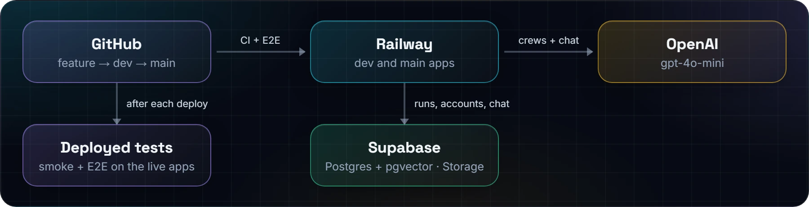
</p>

One Railway project with two environments, `main` and `dev`, each deployed automatically from its branch: merge a PR into `dev` and the dev app updates, then a release PR `dev → main` updates the stable app. The service is defined as code in [`.railway/railway.ts`](.railway/railway.ts) (start command, health check, a 500 MB volume for runs). Each environment has its own Supabase project.

To deploy by hand instead:

```powershell
railway login
railway link --project <project-id> --environment dev
railway up --environment dev
```

Secrets (`OPENAI_API_KEY`, the Google sign-in keys, `AUTH_COOKIE_SECRET`, `FORESIGHT_DEVELOPERS`, `RESEND_API_KEY`, and each environment's Supabase URL and key) go from your local `.env` to Railway with `.\scripts\push_secrets_to_railway.ps1`, which never prints them. Setup of Google sign-in, Supabase and the migrations: [Technical reference › Deployment](docs/Architecture/Technical%20reference.md#deployment-railway).

## Project structure

```
app/            Streamlit app (entry point app/streamlit_app.py; store.py is all access to run data)
src/foresight/  the pipeline: flow.py, data/, analytics/, crews/ (YAML agents and tasks), rag/, registry/, tools/, validation/
config/         settings.yaml and the committed Data Contract
knowledge/      background documents for the AI investigator (+ SOURCES.md)
artifacts/      the committed reference analysis
supabase/       versioned SQL migrations
tests/          unit/, integration/, app/, smoke/, e2e/
scripts/        data download, evaluations, measurements; take_screenshots.py and readme_art.py (this page's pictures)
docs/           Obsidian vault: requirements, 38 decisions (ADRs), milestones, results, lessons learned
```

## Documentation

- [Technical reference](docs/Architecture/Technical%20reference.md): every stage, crew, check, page and setting in detail
- [Decisions](docs/Decisions): 38 ADRs, from the dataset choice to plain names in the app
- [Milestones](docs/Milestones): what each phase built, its test results and lessons
- [Results](docs/Results): the retrieval and prompt-injection evaluations
- [Requirements](docs/Requirements/PROJECT_REQUIREMENTS.md) and [proposal](docs/Requirements/PROJECT_PROPOSAL.md)

## License

MIT, see [LICENSE](LICENSE). SECOM data: CC BY 4.0 (UCI).
